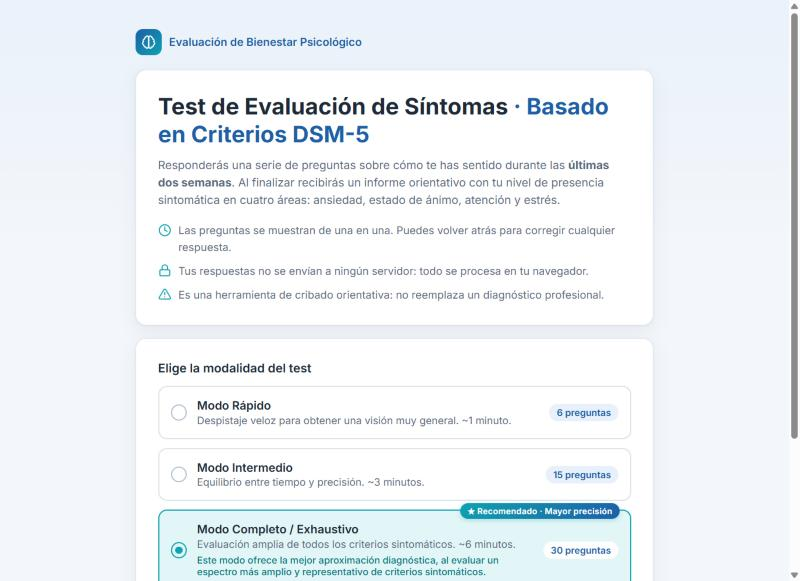
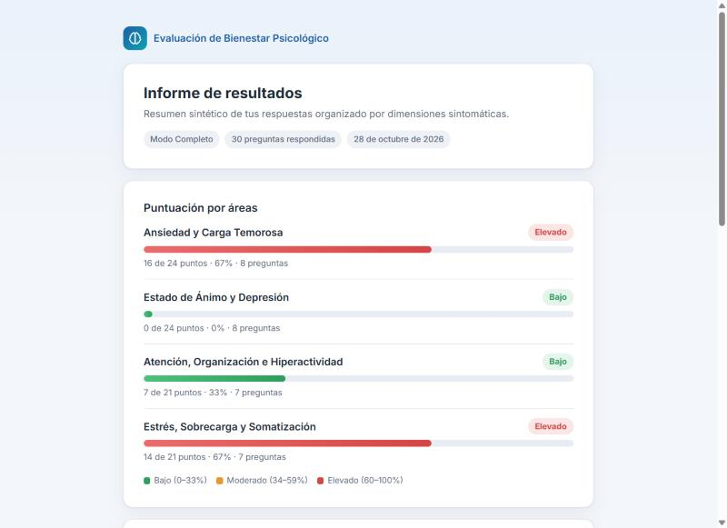

# Test de Evaluación de Síntomas · Basado en DSM-5

Aplicación web de página única que aplica un **test psicotécnico de cribado** sobre cuatro dimensiones sintomáticas inspiradas en los criterios del DSM-5, y genera al instante un informe orientativo.

**Demo en vivo:** https://diosmel84.github.io/test_motor_psico/

| Pantalla de inicio | Informe de resultados |
|---|---|
|  |  |

> ⚠️ **Aviso:** esta herramienta es puramente informativa, orientativa y educativa. **No constituye un diagnóstico clínico** ni sustituye la evaluación de un profesional de la salud mental.

## Características

- **Tres modalidades:** Rápido (6 preguntas), Intermedio (15) y Completo (30). El modo completo es el recomendado y ofrece la mejor aproximación.
- **Cuatro áreas evaluadas:**
  1. Ansiedad y Carga Temorosa
  2. Estado de Ánimo y Depresión
  3. Atención, Organización e Hiperactividad
  4. Estrés, Sobrecarga y Somatización
- **Escala Likert de 4 puntos** (0 = Nunca … 3 = Casi siempre), referida a las últimas dos semanas.
- **Una pregunta a la vez**, con barra de progreso, botones Anterior/Siguiente, avance automático opcional y atajos de teclado (teclas 1–4 y flechas).
- **Informe final** con:
  - nivel por área (Bajo / Moderado / Elevado) y barras de colores,
  - resumen escrito generado según el patrón de respuestas,
  - tres recomendaciones prácticas de higiene mental,
  - aviso legal destacado,
  - alerta de ayuda inmediata si se indican pensamientos de autolesión,
  - opción de imprimir o guardar como PDF.
- **Juego de atención (opcional, ~2 min):** tarea Go/No-Go de 60 figuras (75 % "responder", 25 % "no responder"). Mide tiempo de reacción medio, omisiones (atención sostenida), errores de impulsividad (control inhibitorio) y variabilidad de respuesta. Es educativo: no detecta ni diagnostica TDAH.
- **Privacidad:** todo se procesa en el navegador; no se envía ningún dato a un servidor.
- **Diseño responsivo** (mobile-first) y accesible: roles ARIA, foco visible y respeto por `prefers-reduced-motion`.

## Cómo funciona la puntuación

Cada área suma los puntos de sus preguntas y se expresa como porcentaje del máximo posible:

| Porcentaje | Nivel |
|---|---|
| 0 – 33 % | Bajo |
| 34 – 59 % | Moderado |
| 60 – 100 % | Elevado |

Los modos cortos usan primero los indicadores nucleares de cada área (similares a los del PHQ-2 y el GAD-2), y las preguntas de distintas áreas se alternan para que no aparezcan en bloques.

## Tecnologías

- HTML5
- CSS3 (variables, grid, flexbox, media queries)
- JavaScript Vanilla (sin frameworks ni dependencias)

Todo el código está en un único archivo: [`index.html`](index.html).

## Uso local

No necesita instalación ni servidor: descarga el repositorio y abre `index.html` con doble clic en cualquier navegador.

```bash
git clone https://github.com/Diosmel84/test_motor_psico.git
```

## Autor

Desarrollado por **Diosmel84** como proyecto personal.
